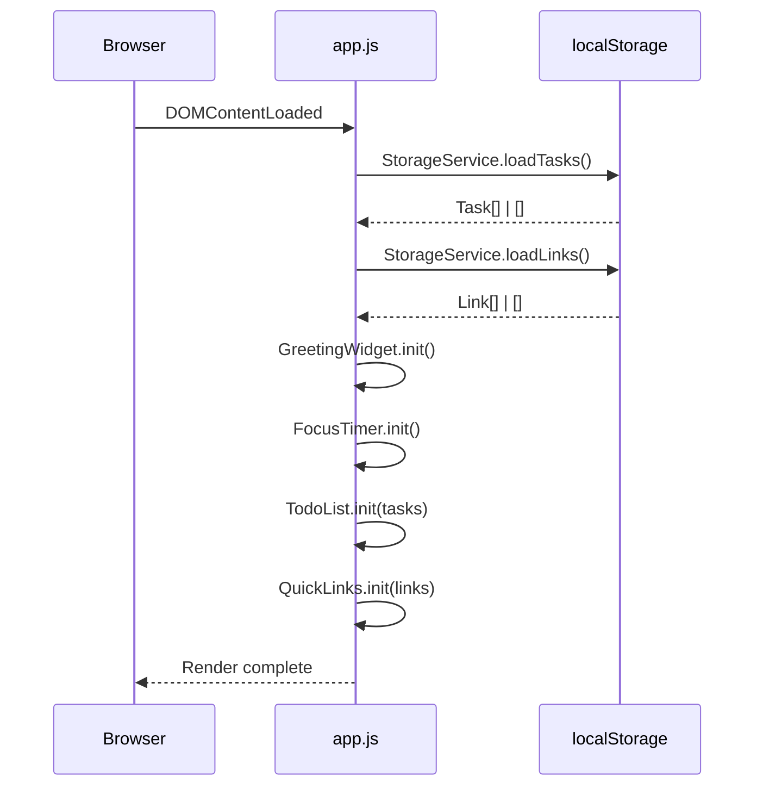

# Design Document — Todo List Life Dashboard

## Overview

The **Todo List Life Dashboard** is a standalone, zero-dependency single-page application (SPA) delivered as a set of static files: one HTML file, one CSS file, and one JavaScript file. It runs entirely in the browser with no build step and no server. All application state is persisted through the browser's `localStorage` API.

The application is composed of four independent widgets rendered inside a single HTML page:

| Widget | Responsibility |
|---|---|
| `Greeting_Widget` | Displays current time (live), current date, and a time-based greeting |
| `Focus_Timer` | Runs a 25-minute Pomodoro countdown with Start / Stop / Reset |
| `Todo_List` | Manages a persistent, ordered list of tasks (add, edit, complete, delete) |
| `Quick_Links` | Manages a persistent set of user-defined shortcut links (add, open, delete) |

### Goals

- No external libraries, frameworks, or build tools required.
- Fully functional in Chrome, Firefox, Edge, and Safari (modern versions).
- Packagable as a browser extension without modification.
- All state survives page refreshes via `localStorage`.
- Accessible and readable at viewports ≥ 1024px; responsive single-column layout at < 768px.

---

## Architecture

The application follows a **module-per-widget** architecture within a single JavaScript file. Each widget is an immediately-invoked or explicitly-initialized module object responsible for its own DOM manipulation, state management, and localStorage I/O.

```
index.html
├── css/
│   └── style.css          ← all styles (single file)
└── js/
    └── app.js             ← all behaviour (single file)
        ├── StorageService  ← thin wrapper around localStorage
        ├── GreetingWidget  ← time/date/greeting display
        ├── FocusTimer      ← countdown timer logic
        ├── TodoList        ← task CRUD + persistence
        └── QuickLinks      ← link CRUD + persistence
```

### Initialization Flow



### Widget Lifecycle

Each widget module exposes an `init()` function called once on `DOMContentLoaded`. Widgets manage their own internal state and interact with the `StorageService` directly for persistence operations.

---

## Components and Interfaces

### StorageService

Thin wrapper isolating all `localStorage` calls. Centralises error handling for unavailable or corrupted storage.

```js
StorageService = {
  loadTasks()  → Task[]      // returns [] on error/missing
  saveTasks(tasks: Task[])   // swallows write errors, surfaces via callback
  loadLinks()  → Link[]      // returns [] on error/missing
  saveLinks(links: Link[])   // swallows write errors, surfaces via callback
}
```

- All reads are wrapped in `try/catch`; malformed JSON returns `[]`.
- All writes are wrapped in `try/catch`; on failure an optional `onError` callback is invoked so the widget can surface an error message.

### GreetingWidget

```js
GreetingWidget = {
  init()           // starts the 1-second interval, renders immediately
  _render()        // updates DOM with current time, date, greeting
  _getGreeting(hour: number) → string   // pure function: maps hour → greeting
  _formatTime(date: Date) → string      // pure: returns "hh:mm:ss AM/PM"
  _formatDate(date: Date) → string      // pure: returns "Day, Month DD, YYYY"
}
```

- `init()` calls `_render()` immediately, then `setInterval(_render, 1000)`.
- `_getGreeting` is a pure function with no side effects — directly testable.

### FocusTimer

```js
FocusTimer = {
  init()                    // sets initial state, wires button listeners
  _start()                  // begins or resumes countdown
  _stop()                   // pauses countdown, retains remaining time
  _reset()                  // clears interval, resets to 25:00
  _tick()                   // decrements remaining seconds; stops at 0
  _render()                 // updates DOM display
  _formatTime(seconds: number) → string   // pure: "MM:SS"
}
```

State held in module-scoped variables: `remainingSeconds`, `intervalId`, `isRunning`.

### TodoList

```js
TodoList = {
  init(tasks: Task[])         // hydrates state, renders list
  _addTask(text: string)      // validates, creates Task, persists, renders
  _editTask(id, newText)      // validates, updates Task, persists, re-renders
  _toggleTask(id)             // flips completion, persists, re-renders
  _deleteTask(id)             // removes Task, persists, re-renders
  _persist()                  // calls StorageService.saveTasks()
  _renderList()               // full re-render of task list DOM
  _renderTask(task: Task) → HTMLElement
}
```

State: module-scoped `tasks: Task[]` array.

### QuickLinks

```js
QuickLinks = {
  init(links: Link[])         // hydrates state, renders panel
  _addLink(label, url)        // validates, creates Link, persists, renders
  _deleteLink(id)             // removes Link, persists, re-renders
  _openLink(url)              // validates URL, opens in new tab or shows error
  _persist()                  // calls StorageService.saveLinks()
  _renderPanel()              // full re-render of link buttons DOM
  _isValidAbsoluteURL(url: string) → boolean  // pure validation function
}
```

State: module-scoped `links: Link[]` array.

---

## Data Models

### Task

```js
{
  id:        string,   // crypto.randomUUID() or Date.now() + Math.random() fallback
  text:      string,   // 1–200 characters, trimmed
  completed: boolean   // false on creation
}
```

localStorage key: `"dashboard_tasks"`  
Stored as: `JSON.stringify(Task[])`

### Link

```js
{
  id:    string,   // crypto.randomUUID() or fallback
  label: string,   // 1–50 characters, trimmed
  url:   string    // 1–2048 characters; must begin with "http://" or "https://"
}
```

localStorage key: `"dashboard_links"`  
Stored as: `JSON.stringify(Link[])`

### Storage Schema

```
localStorage
├── "dashboard_tasks"  →  JSON string of Task[]
└── "dashboard_links"  →  JSON string of Link[]
```

On load, each entry is parsed with `JSON.parse()` inside `try/catch`. If parsing throws, or the result is not an array, the widget initialises with `[]` and the corrupt entry is discarded (not re-written until next save).

---

## Correctness Properties

*A property is a characteristic or behavior that should hold true across all valid executions of a system — essentially, a formal statement about what the system should do. Properties serve as the bridge between human-readable specifications and machine-verifiable correctness guarantees.*

### Property 1: Time-Based Greeting Coverage

*For any* hour value in [0, 23], `_getGreeting(hour)` SHALL return exactly one of {"Good Morning", "Good Afternoon", "Good Evening", "Good Night"} and the mapping SHALL be exhaustive with no gaps or overlaps.

**Validates: Requirements 1.4, 1.5, 1.6, 1.7**

---

### Property 2: Time Format Round-Trip

*For any* `Date` object, `_formatTime(date)` SHALL produce a string that matches the regex `/^\d{2}:\d{2}:\d{2} (AM|PM)$/` and the extracted hours, minutes, and seconds SHALL be numerically equal to those in the original `Date` (converted to 12-hour scale).

**Validates: Requirements 1.1, 1.2**

---

### Property 3: Task Addition Grows the List

*For any* task list state and any valid (non-empty, non-whitespace-only) task text, calling `_addTask` SHALL increase the length of the task list by exactly 1 and the new task's text SHALL equal the trimmed input.

**Validates: Requirements 3.2**

---

### Property 4: Whitespace-Only Task Text Is Rejected

*For any* string composed entirely of whitespace characters (space, tab, newline), `_addTask` SHALL not modify the task list and the list length SHALL remain unchanged.

**Validates: Requirements 3.3**

---

### Property 5: Task Serialization Round-Trip

*For any* array of `Task` objects, `JSON.parse(JSON.stringify(tasks))` SHALL produce an array that is deeply equal to the original (all `id`, `text`, and `completed` fields preserved).

**Validates: Requirements 8.1, 8.2, 8.5**

---

### Property 6: Link Serialization Round-Trip

*For any* array of `Link` objects, `JSON.parse(JSON.stringify(links))` SHALL produce an array that is deeply equal to the original (all `id`, `label`, and `url` fields preserved).

**Validates: Requirements 8.1, 8.2, 8.5**

---

### Property 7: Completion Toggle Is Its Own Inverse

*For any* task, toggling `completed` twice SHALL return the task to its original `completed` state (round-trip idempotence).

**Validates: Requirements 5.2, 5.3**

---

### Property 8: URL Validation Accepts Valid Absolute URLs and Rejects Invalid Ones

*For any* string that begins with `"http://"` or `"https://"` followed by at least one character, `_isValidAbsoluteURL` SHALL return `true`. *For any* string that does not begin with `"http://"` or `"https://"`, it SHALL return `false`.

**Validates: Requirements 6.2, 6.3, 7.4**

---

### Property 9: Quick Links Cap Enforcement

*For any* link list that has already reached 20 entries, calling `_addLink` SHALL not increase the list length beyond 20 and the submit control SHALL be disabled.

**Validates: Requirements 7.8**

---

### Property 10: Timer Format Correctness

*For any* integer `seconds` in [0, 1500] (the valid range for a 25-minute timer), `_formatTime(seconds)` SHALL return a string matching `/^\d{2}:\d{2}$/` where the minutes and seconds values are arithmetically correct.

**Validates: Requirements 2.1, 2.5**

---

## Error Handling

| Scenario | Component | Handling |
|---|---|---|
| `localStorage` unavailable on read | `StorageService` | `try/catch` returns `[]`; widget initialises empty |
| Malformed JSON in `localStorage` | `StorageService` | `JSON.parse` throws → caught → returns `[]` |
| `localStorage` unavailable on write | `StorageService` | `try/catch` invokes `onError` callback |
| Write failure during edit/toggle/delete | `TodoList` / `QuickLinks` | Widget displays inline error message; in-memory state kept |
| Invalid URL on link click | `QuickLinks._openLink` | No navigation; inline error shown next to button |
| Invalid URL on link add | `QuickLinks._addLink` | Link not added; inline validation message shown |
| Empty/whitespace task submission | `TodoList._addTask` | Task not added; input retains focus |
| Empty label or URL on link add | `QuickLinks._addLink` | Link not added; message identifies missing field |
| Timer reaches 00:00 | `FocusTimer._tick` | `clearInterval`, display "Session complete!" |

No uncaught exceptions should propagate to the browser console from any of the above paths.

---

## Testing Strategy

### Unit Tests (Example-Based)

Unit tests cover specific scenarios and edge cases. A lightweight test runner like [QUnit](https://qunitjs.com/) or plain `assert` functions work well for a zero-dependency project.

**GreetingWidget**
- `_getGreeting(0)` → `"Good Night"`
- `_getGreeting(5)` → `"Good Morning"`
- `_getGreeting(12)` → `"Good Afternoon"`
- `_getGreeting(18)` → `"Good Evening"`
- `_getGreeting(21)` → `"Good Night"`
- `_formatTime` returns correct AM/PM for midnight and noon edge cases

**FocusTimer**
- `_formatTime(0)` → `"00:00"`
- `_formatTime(1500)` → `"25:00"`
- `_formatTime(90)` → `"01:30"`
- Start when already running takes no action (idempotent)
- Stop when not running takes no action
- Reset while running clears interval and shows `25:00`
- Reaching `00:00` shows "Session complete!" and stops

**TodoList**
- Adding a task with leading/trailing spaces stores trimmed text
- Submitting empty string does not add task
- Submitting `"   "` (spaces only) does not add task
- Editing with empty string retains original text
- Cancelling edit retains original text
- Delete removes exactly the targeted task
- `localStorage` write failure shows error message

**QuickLinks**
- Adding a link with missing label shows validation message
- Adding a link with missing URL shows validation message
- Adding a link with `"ftp://example.com"` shows invalid URL message
- Adding the 20th link disables submit; adding the 21st is blocked
- Clicking a link with valid URL opens new tab
- Clicking a link with invalid URL shows inline error

**StorageService**
- Malformed JSON returns `[]` with no thrown error
- Missing key returns `[]` with no thrown error

### Property-Based Tests

Use [fast-check](https://fast-check.io/) (importable via CDN as an ES module, or in a separate test HTML page) for property tests. Each property test runs a **minimum of 100 iterations**.

Each property test must include a comment in the form:

```
// Feature: todo-list-life-dashboard, Property N: <property text>
```

| Test | Library Property | Iterations |
|---|---|---|
| Property 1 — Greeting coverage | Generate integer in [0,23]; assert exactly one greeting returned | 100+ |
| Property 2 — Time format | Generate random `Date`; assert format regex and value correctness | 100+ |
| Property 3 — Task addition | Generate task list + valid text; assert list grows by 1 | 100+ |
| Property 4 — Whitespace rejection | Generate whitespace-only strings; assert list unchanged | 100+ |
| Property 5 — Task serialisation | Generate `Task[]`; assert round-trip equality | 100+ |
| Property 6 — Link serialisation | Generate `Link[]`; assert round-trip equality | 100+ |
| Property 7 — Toggle inverse | Generate task; assert double-toggle restores state | 100+ |
| Property 8 — URL validation | Generate valid and invalid URL strings; assert correct boolean | 100+ |
| Property 9 — Links cap | Generate link list of 20 + extra link; assert capped at 20 | 100+ |
| Property 10 — Timer format | Generate integer in [0,1500]; assert format and arithmetic | 100+ |

### Integration / Smoke Tests

- Load `index.html` in each target browser; verify all four widgets render.
- Confirm data persists across page reload (add task → reload → task still present).
- Confirm malformed `localStorage` entries are silently discarded on load.
- Confirm responsive layout at 767px viewport width (single-column, no clipping).
- Confirm contrast ratio ≥ 4.5:1 using browser DevTools accessibility panel.
